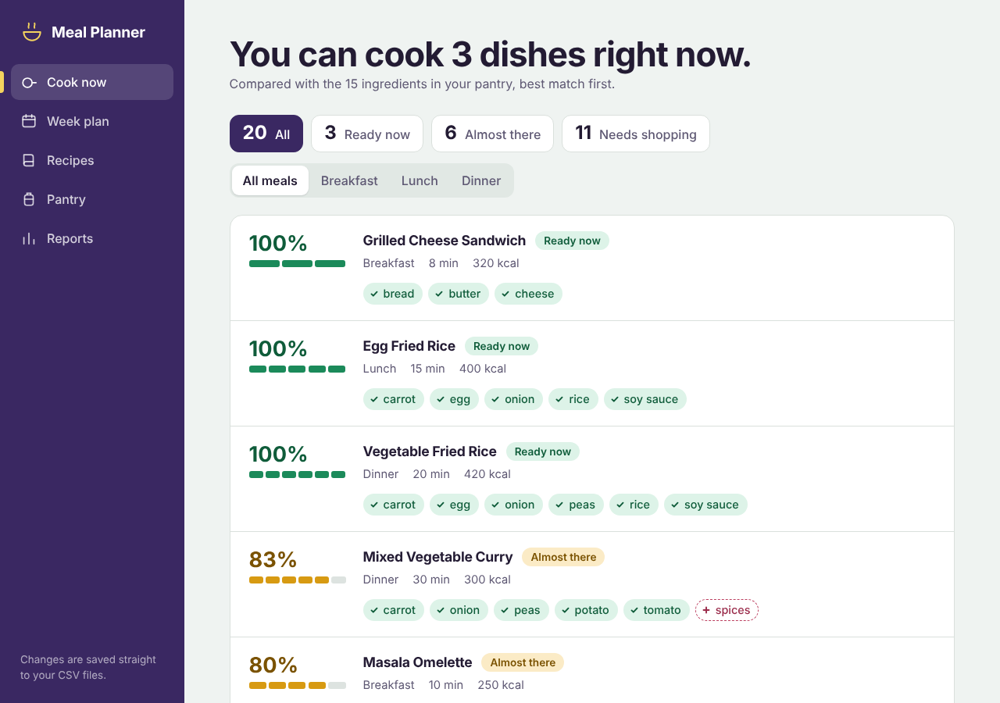
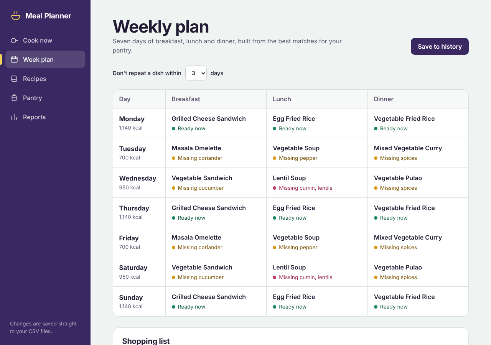
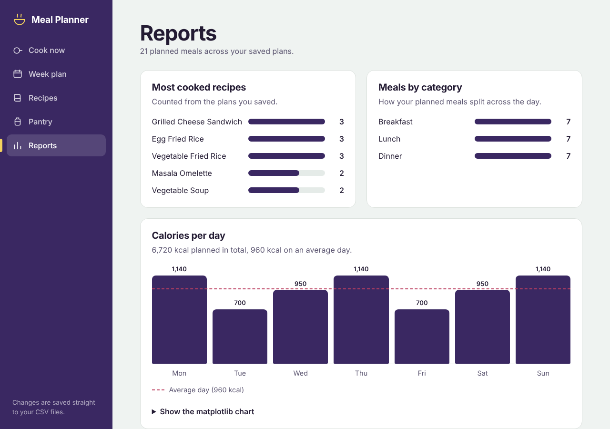
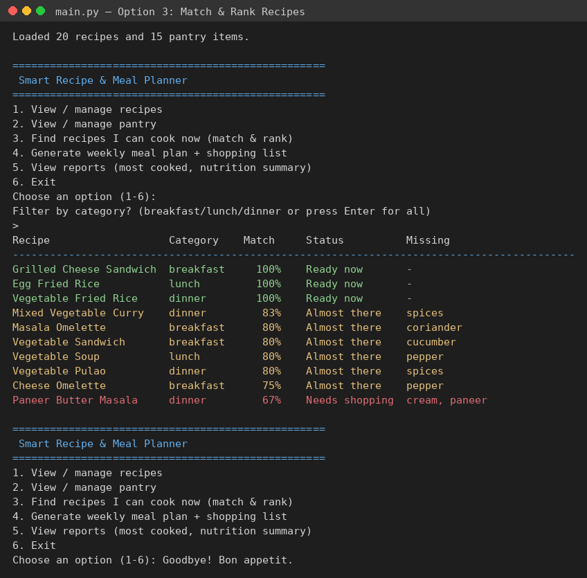
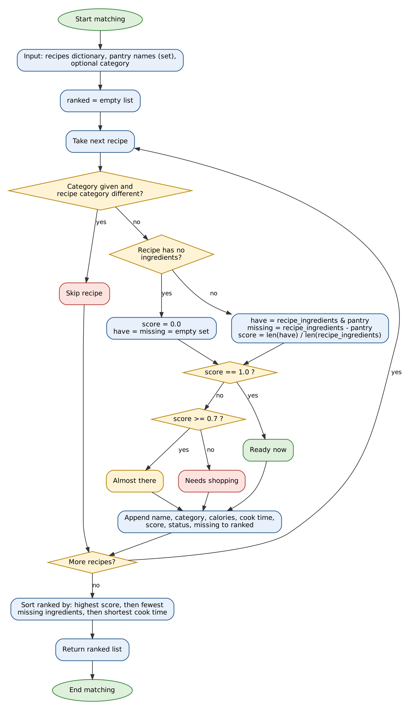
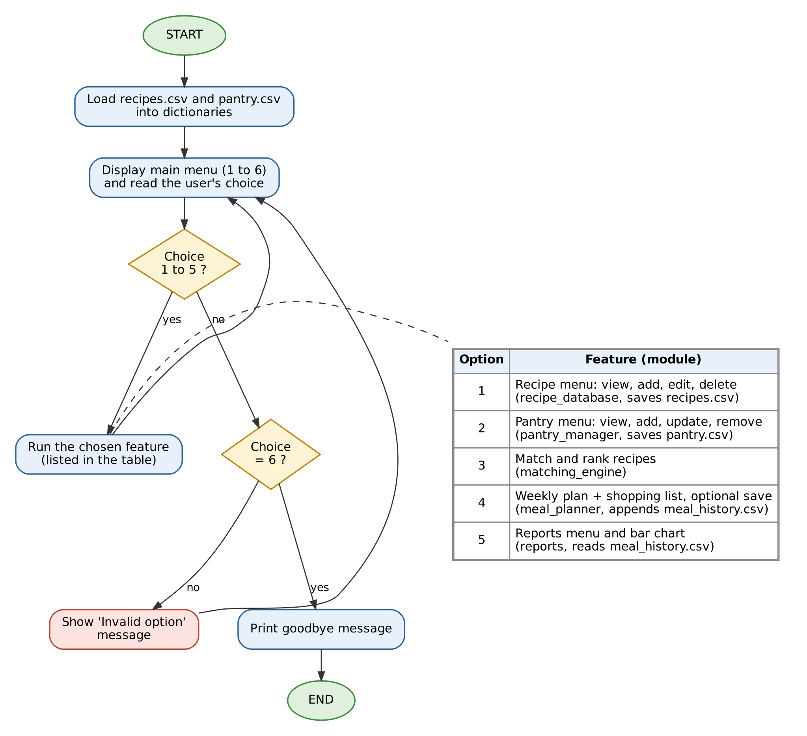

# Smart Recipe & Meal Planner

A Python application, with a **browser interface** and a command-line menu, that compares the ingredients you already have with a recipe
database. It tells you what you can cook **right now**, what you are **almost ready** to cook and
what needs a shopping trip, then builds a **7-day meal plan** and a **shopping list** automatically.
It is rule-based (no machine learning), works offline and stores its data in plain CSV files.

> Group project for **Computational Thinking and Programming (2026CSAE100)**,
> School of Computer Science Engineering and Technology, Bennett University.

## Features

- **Web interface:** the same features in a browser (Flask), with ranked recipe cards, a weekly plan grid, a tick-off shopping list and report charts. The command-line menu still works.
- **Recipe database:** add, view (with category filter), edit and delete recipes, stored in `recipes.csv`.
- **Pantry manager:** add (quantities merge when the unit matches), update, remove and view ingredients, stored in `pantry.csv`.
- **Match and rank engine (core feature):** compares your pantry with every recipe using Python sets, gives each recipe a match score and a status (`Ready now`, `Almost there` or `Needs shopping`) and ranks them best first.
- **Weekly meal planner:** 7 days x 3 meals, avoids repeating a recipe within 3 days where alternatives exist, and builds a shopping list of everything missing.
- **Reports:** most-cooked recipes, category breakdown, calorie summary and a bar chart, built from the saved meal history.
- **Input validation everywhere:** every prompt re-asks until the value is valid, and most accept `cancel`.

## Quick start

Requires **Python 3.8 or newer**. The standard library is enough for everything except the bar chart, which
needs `matplotlib`.

```bash
git clone https://github.com/<your-username>/smart-meal-planner.git
cd smart-meal-planner

# optional: only needed for the bar chart (Reports menu, option 4)
pip install -r requirements.txt

python app.py           # web interface: opens http://127.0.0.1:5000 (needs: pip install flask)
python main.py          # command-line menu (no extra install)
```

`python main.py` must be run from inside the project folder, because it opens the CSV files by relative name.
`python app.py` finds the CSV files next to itself, so it works from anywhere.

## Using the program

| Menu option | What it does |
|---|---|
| 1. View / manage recipes | View all recipes or one category, add, edit or delete a recipe. |
| 2. View / manage pantry | View the pantry, add an ingredient, update a quantity or remove an ingredient. |
| 3. Find recipes I can cook now | Optional category filter, then every recipe ranked by readiness with the exact missing ingredients. |
| 4. Generate weekly meal plan | Prints the plan as a grid, then the shopping list, and asks whether to save the plan to `meal_history.csv`. |
| 5. View reports | Most cooked, category breakdown, nutrition summary and the bar chart (`reports_chart.png`). |
| 6. Exit | Quits the program. |

Changes made in the recipe and pantry menus are saved straight back to the CSV files.

## Web interface

`python app.py` starts a small Flask server and opens the app in your browser. It is a front end only:
`app.py` calls the same functions as the command-line menu (`rank_recipes`, `generate_meal_plan`,
`build_shopping_list`, `save_meal_plan`, `nutrition_summary` and so on), so the results are identical and
the CSV files stay the single source of truth. Input validation follows the same rules as the menus.

| Page | What it does |
|---|---|
| Cook now | Every recipe ranked by readiness. Each ingredient is shown as in pantry or missing, with filters for readiness and meal type. |
| Week plan | The 7-day plan as a grid, the shopping list (tick items off as you buy them) and a Save to history button. |
| Recipes | Search, filter, add, edit and delete recipes. |
| Pantry | Add ingredients (same unit adds up, a different unit asks before replacing), edit quantities in place, remove items. |
| Reports | Most cooked recipes, category breakdown, calories per day and the matplotlib chart from `reports.py`. |







## Sample output

Option 3 on the included sample data (20 recipes, 15 pantry items):



Option 4 (weekly plan and shopping list) on the same data:

```text
Day         Breakfast               Lunch                   Dinner                  
------------------------------------------------------------------------------------
Monday      Grilled Cheese Sandwich Egg Fried Rice          Vegetable Fried Rice    
Tuesday     Masala Omelette         Vegetable Soup          Mixed Vegetable Curry   
Wednesday   Vegetable Sandwich      Lentil Soup             Vegetable Pulao         
Thursday    Grilled Cheese Sandwich Egg Fried Rice          Vegetable Fried Rice    
Friday      Masala Omelette         Vegetable Soup          Mixed Vegetable Curry   
Saturday    Vegetable Sandwich      Lentil Soup             Vegetable Pulao         
Sunday      Grilled Cheese Sandwich Egg Fried Rice          Vegetable Fried Rice    

Shopping list (ingredient - number of planned recipes needing it):
  spices (x4)
  coriander (x2)
  cucumber (x2)
  cumin (x2)
  lentils (x2)
  pepper (x2)
```

## How the core algorithm works

`matching_engine.py` treats the pantry and each recipe's ingredient list as sets:

```python
have        = recipe_ingredients & pantry_ingredients    # what you already have
missing     = recipe_ingredients - pantry_ingredients    # what you still need
match_score = len(have) / len(recipe_ingredients)         # 0.0 to 1.0
```

| Match score | Status |
|---|---|
| 100% | Ready now |
| 70% to 99% | Almost there |
| below 70% | Needs shopping |

Recipes are ranked by highest score, then fewest missing ingredients, then shortest cook time.
The meal planner picks, for each day and slot, the best-ranked recipe of that category that was not
used in the last 3 days, and relaxes that rule rather than leaving a slot empty.



## Project structure

```text
smart-meal-planner/
├── main.py                  # entry point: the command-line menu that ties the modules together
├── app.py                   # entry point: web interface (Flask server and JSON API)
├── templates/index.html     # the single page of the web interface
├── static/                  # style.css and app.js for the web interface
├── recipe_database.py       # recipe CRUD and CSV storage
├── pantry_manager.py        # pantry CRUD and CSV storage
├── matching_engine.py       # core matching, scoring and ranking
├── meal_planner.py          # weekly plan and shopping list
├── reports.py               # usage reports and bar chart
├── recipes.csv              # sample recipes (20)
├── pantry.csv               # sample pantry (15 ingredients)
├── meal_history.csv         # one saved sample week (21 meals)
├── requirements.txt         # matplotlib (bar chart), flask (web interface)
├── tests/
│   ├── report_test_cases.py # 13 test cases run against the real modules
│   └── test_web_api.py      # 11 tests of the web interface's API
└── docs/
    ├── diagrams/            # flowcharts, decision trees, object model, charts
    └── screenshots/         # program output
```

## Data files

All three files have a header row and can be opened or edited in Excel or a text editor.

- `recipes.csv`: `name, ingredients (semicolon-separated), category, calories, cook_time`
- `pantry.csv`: `ingredient, quantity, unit`
- `meal_history.csv`: `day, slot, recipe` (a plan is appended each time you save one)

## Testing

`tests/report_test_cases.py` runs 13 test cases (normal, boundary, invalid-input and special cases) against
the real modules. Interactive functions are driven with simulated keyboard input and file functions use
temporary files, so the real CSV files are never changed.

```bash
python tests/report_test_cases.py
```

The run ends with `13 of 13 passed`.

The web interface has its own tests, which run against a temporary copy of the CSV files:

```bash
python tests/test_web_api.py
```

## Design documents

The diagrams in [`docs/diagrams`](docs/diagrams) cover the overall program flow, the matching algorithm,
the decomposition of the problem into modules and functions, three decision trees, the object model and
the charts used to interpret the program's output.



## Limitations and future work

- Matching checks whether an ingredient is present, not whether the quantity is enough. A pantry item set to quantity 0 still counts as present.
- The planner always prefers the best-ranked recipe, so a week uses only a few recipes. A variety-aware rule would use more.
- The calorie summary groups days by weekday name, so several saved weeks would be merged.
- The reports count planned meals, not meals actually cooked.

## Team

| Member | Milestone 1 responsibility |
|---|---|
| Yash Raj Pandey | Working prototype of the matching engine and the recipe database |
| Charming Patel | Meal planning logic and program design |
| Priyam Madaan | Problem identification and problem statement |
| Anurag Saha | Initial planning and integration |
| Vansh Kumar | Reports and integration |

## Acknowledgements

Built with the Python standard library (`csv`, `os`, `collections`), [Flask](https://flask.palletsprojects.com/) for the web interface and
[Matplotlib](https://matplotlib.org/). Diagrams were drawn with [Graphviz](https://graphviz.org/).
An AI assistant (Claude, by Anthropic) was used to help write this documentation and prepare the diagrams.
